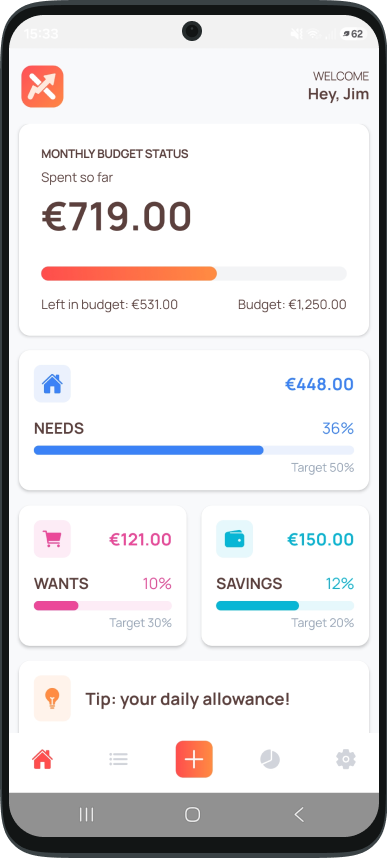
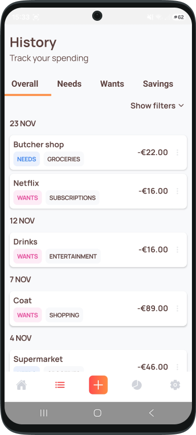
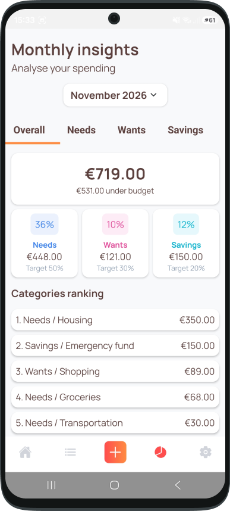

<div align="center">


# XPence

**A budgeting app built around the 50/30/20 rule.**

Set a monthly budget, log your expenses, and see right away whether your Needs, Wants and Savings are on target.


_Coming soon to Google Play._

</div>

---

## Screenshots

| Home | History | Insights | Settings |
|:---:|:---:|:---:|:---:|
|  |  |  |  |

## What it does

XPence splits your monthly budget into three targets: **50% Needs, 30% Wants, 20% Savings**. Every expense belongs to a category, and every category belongs to one of those three types. That's enough for the app to show how your spending compares with the plan.

- **Home dashboard:** what's left in your budget, progress towards each target, and a daily allowance that shows how much you can spend each day to stay within budget until the end of the month.
- **Expense tracking:** add, edit and delete expenses with an amount, date, description and category.
- **History:** an infinite-scrolling list grouped by date, with a separate tab for each type and filters for date range and category.
- **Insights:** monthly totals and a category ranking for each type.
- **Custom categories:** rename, add or remove categories. Past expenses keep their category even after you remove it.
- **Personalisation:** about 30 currencies, and English or Greek, with a matching locale for number and date formats.
- **Account & privacy:** email sign-up with confirmation and in-app Terms and Privacy Policy consent. You can change your password and permanently delete your account and data from inside the app.

## Tech stack

| Area | Choice |
|---|---|
| App | Expo SDK 57, React Native 0.86, React 19 (React Compiler enabled) |
| Navigation | Expo Router (file-based, typed routes) |
| Server state | TanStack React Query |
| Forms & validation | React Hook Form + Zod |
| Backend | Supabase: Postgres, Auth, row-level security, SQL functions |
| i18n | i18next / react-i18next |
| Builds | EAS Build with development, preview and production variants |

## Engineering highlights

- **Money stored as integers in minor units** (cents). No floating-point rounding errors, and parsing accepts both `12.50` and `12,50`.
- **Calendar dates stored as local `YYYY-MM-DD` strings**, not timestamps. An expense logged at 01:00 in Athens doesn't slide into the previous day when it's converted to UTC.
- **Keyset (cursor) pagination** on `(date, id)` for the history list. Pages stay fast and don't skip or repeat rows when you add data while scrolling.
- **Row-level security on every table.** Each user can only read and write their own rows. The client uses only the public anon key.
- **Secure auth:** PKCE flow, sessions kept in the device keychain or keystore through `expo-secure-store`, and token refresh paused while the app is in the background.
- **Aggregation in Postgres:** monthly summaries and insights are calculated by SQL functions called over RPC, instead of downloading every expense to the device.
- **Typed from the database to the UI:** Supabase-generated database types, a `Result<T>` return type for the API layer, and Zod schemas for every form.
- **Three build variants** (`development`, `preview`, `production`) from one `app.config.js`, each with its own package ID, so all three can be installed side by side.

## Project structure

```text
app/            Expo Router screens
  (auth)/       onboarding, login / sign-up, email callback
  (app)/        home, add expense, history, insights, settings
api/            Supabase data access (users, expenses, categories)
hooks/          React Query hooks
components/     shared and feature-specific UI
constants/      theme, currencies, locales, 50/30/20 split
languages/      en.json, gr.json
lib/            Supabase client, secure storage, i18n, helpers
supabase/       migrations and local Supabase config
types/          app and generated database types
```

## Running it locally

**Prerequisites:** Node.js 20+, npm, and a [Supabase](https://supabase.com) project of your own. Use Android Studio or Xcode for an emulator or simulator, or a physical device.

1. **Install dependencies**
   ```bash
   npm install
   ```
2. **Set up the database.** Link the Supabase CLI (installed as a dev dependency) to your project and apply the migrations:
   ```bash
   npx supabase link --project-ref <your-project-ref>
   npx supabase db push
   ```
3. **Configure environment variables.** Create a `.env.local` file in the project root:
   ```bash
   EXPO_PUBLIC_SUPABASE_URL=https://<your-project-ref>.supabase.co
   EXPO_PUBLIC_SUPABASE_ANON_KEY=<your-anon-key>
   ```
4. **Build a development client.** The app uses native modules, so Expo Go won't work. Either build locally:
   ```bash
   npx expo run:android   # or: npx expo run:ios
   ```
   or with EAS:
   ```bash
   npm run build-dev
   ```
5. **Start the dev server**
   ```bash
   npm start
   ```

Other scripts: `npm run lint`, `npm run build-preview` (installable APK) and `npm run build-production`.

## Roadmap

- [ ] Google Play release
- [ ] Password reset ("forgot password") flow
- [ ] Recurring expenses
- [ ] Unit tests and CI
- [ ] Crash reporting

## License

[MIT](LICENSE) © 2026 Antonis Margaronis
